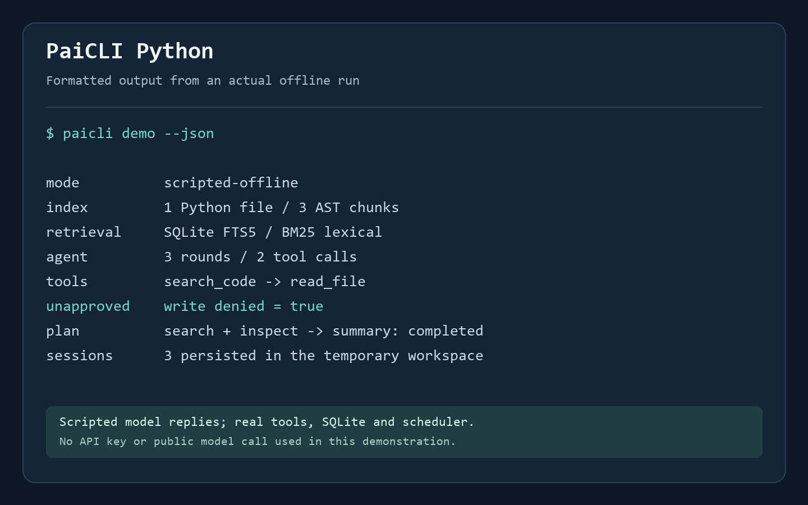

# PaiCLI Python

**A Python coding agent and AI platform operations CLI with observable tool calls, exact write approvals, and repeatable offline examples.**

English | [简体中文](README_ZH.md)

PaiCLI Python combines a bounded model/tool loop, local code retrieval, session persistence, and read-only platform diagnostics. It is a focused Python implementation for learning, demonstration, and further engineering work.



*Formatted real offline demo output, not a terminal screenshot. The model replies are explicitly scripted; file tools, SQLite storage, retrieval, and scheduling execute real code.*

## Quick start

Requires **Python 3.11+** with SQLite FTS5 support. Run from this repository:

```sh
python -m venv .venv
# Linux/macOS: source .venv/bin/activate
# Windows PowerShell: .\.venv\Scripts\Activate.ps1
python -m pip install .
paicli demo --json
```

`demo` needs no API key or network access. It creates and cleans up a temporary workspace, indexes a Python fixture, runs two Agent tools, verifies that an unapproved write is rejected, and executes a three-node DAG. The fixture demonstrates process-local refund idempotency; it is not production payment code.

## What is implemented

| Capability | Implementation |
| --- | --- |
| Agent | ReAct-style request/tool/result loop; non-streaming OpenAI-compatible chat completions and an explicit scripted provider |
| Tools | `read_file`, `list_files`, `search_code`, `write_file`; declared argument schemas and source-path checks |
| Write approval | Full diff and a SHA-256 fingerprint bound to the relative path, previous content, and proposed content; exact interactive approval for every write |
| Sessions | SQLite ledger of system, user, assistant, and tool messages; resumable session IDs and deterministic excerpts of older turns |
| Code retrieval | Python AST chunks plus imports/constants/top-level code, JSX/MJS/CSS/HTML support, bounded windows, FTS5/BM25 ranking, source locations, and stale-content rejection |
| Plans | Validated dependency DAG, bounded `asyncio` concurrency, dependency-result handoff, failure cancellation, and read-only Agent workers |
| Platform operations | DNS/TCP/HTTP diagnostics, authenticated FlowTrail identity/quota/runs/details/event replay, and a read-only POSIX world-writable-file audit |

## Run the included examples

```sh
paicli index --workspace examples/codebase
paicli search "refund_order request_key" --workspace examples/codebase
paicli agent "Inspect refund idempotency" --workspace examples/codebase --script examples/read-and-search.json --session refund-review
paicli plan examples/plan.json --workspace examples/codebase --concurrency 2
paicli sessions --workspace examples/codebase
paicli audit --workspace examples/codebase
```

Run `index` before searching. Indexing rebuilds the local index; changed or deleted files are excluded from search results until the next rebuild. Python functions/classes use AST boundaries, retaining decorators and nested locations. Uncovered module code, including imports and constants, is also indexed. Blocks use at most 100 source lines. JSX, MJS, CJS, CSS, HTML and other supported text files use line windows. Retrieval is lexical and needs no embedding model.

The default provider is `scripted`, which requires `--script` or a script for each plan task. It never silently replaces a failed remote model. All successful commands emit JSON; `--json` is accepted explicitly. JSON output uses ASCII-safe Unicode escapes for locale-independent pipes; parsing restores the original Unicode text. Use `paicli <command> --help` for options.

### Inspect and approve a write

```sh
paicli agent "Propose a review note" --workspace examples/codebase --script examples/write-proposal.json --interactive-approval
```

The CLI displays the complete diff. Type `approve <full-64-character-fingerprint>` exactly as prompted. Without the flag, a TTY, or the exact response, the write is denied. If the target changes after preview or the deadline expires while waiting, it is not replaced. A successful write uses an atomic file replacement.

The example's final sentence is scripted; inspect the tool `trace` and file contents to determine whether approval succeeded. An Agent can finish normally after reporting a denied tool, so exit code `0` alone does not prove that every tool succeeded.

## Connect a model or FlowTrail

Credentials are read from process environment variables only. `.env.example` contains placeholders; the CLI does not automatically load `.env` files.

```sh
export OPENAI_API_KEY="<your-api-key>"
paicli agent "Inspect refund idempotency" --workspace examples/codebase --provider openai --base-url https://api.openai.com/v1 --model YOUR_MODEL

export FLOWTRAIL_API_TOKEN="<your-issued-access-token>"
paicli doctor http://127.0.0.1:8000/healthz
paicli platform me --base-url http://127.0.0.1:8000
paicli platform quota --base-url http://127.0.0.1:8000
paicli platform runs --base-url http://127.0.0.1:8000
paicli platform run RUN_ID --base-url http://127.0.0.1:8000
paicli platform events RUN_ID --after 3 --base-url http://127.0.0.1:8000
```

In PowerShell, set variables with `$env:OPENAI_API_KEY = "<your-api-key>"` and `$env:FLOWTRAIL_API_TOKEN = "<your-issued-access-token>"` instead of `export`.

The five platform commands send `Authorization: Bearer …` to the corresponding FlowTrail read-only API and do not print the token. `events` fetches history with `follow=false`, sends `Last-Event-ID` for `--after`, and emits `{events, cursor}` JSON. Identity, quota arithmetic, run/node structure, and SSE event IDs are validated. Invalid, out-of-order, incomplete, oversized, or over-4,096-event responses fail explicitly rather than return partial success. Responses are limited to 1 MiB, with a default total request deadline of 10 seconds, including streamed chunks.

Supply an unexpired access token issued by your FlowTrail instance. Expired/revoked credentials return 401; permission errors and foreign resource IDs remain failures. `doctor` independently reports DNS, TCP, and HTTP checks, using `/healthz` by default. Credentialed remote endpoints require HTTPS; loopback HTTP is supported for local development. Redirects are not followed. HTTP errors omit response bodies and credentials.

### Reproduce the two-project integration

Clone `flowtrail-python` beside this repository and install both projects into one Python environment:

```sh
python -m pip install -e . -e ../flowtrail-python
python scripts/integration_flowtrail.py --flowtrail-src ../flowtrail-python/src
```

The script starts a real local FlowTrail process with a temporary database and random temporary tokens. It exercises all five CLI queries, object quota changes, idempotent submission, cursor replay, invalid credentials, viewer restrictions and cross-tenant reads. The workflow contains explicitly labeled mock inference. It prints only a check summary and cleans up the process and database. This is a separate integration gate, in addition to the standalone unit suite.

Remote models receive the supplied conversation and tool results, which can include workspace source text. Session messages are stored locally in plaintext at `.paicli/state.sqlite3`; that directory is ignored by Git.

## Limits and execution boundaries

- Agent defaults: 8 rounds, 16 calls per round, a 24,000-character serialized context budget, and a 60-second time budget. The character budget is not a tokenizer. Older whole turns are replaced with deterministic excerpts; the current turn must fit.
- Plan defaults: concurrency `2` (allowed `1–8`) and a 120-second time budget. Duplicate IDs, missing dependencies, and cycles are rejected before workers start. Workers cannot write files. A failure cancels outstanding tasks and stops dependent work.
- Asynchronous model calls and plan tasks support cancellation. Local filesystem operations and interactive input use cooperative deadline checks; a blocked human prompt cannot be forcibly interrupted by `asyncio`.
- Paths are restricted to the workspace. Parent traversal, absolute paths, protected paths, symbolic links, Windows reparse points/device names, and hard-linked files are rejected. These are application checks, **not an OS sandbox**; hostile concurrent filesystem changes require OS/container isolation.
- File reads and indexed files are capped at 512 KiB; proposed writes at 256 KiB. Indexing scans up to 5,000 allowed files. These defaults target local codebases; no large-scale throughput claim is made.
- `audit` checks POSIX world-write mode bits without changing permissions. It does not analyze Windows ACLs.

This release does not implement MCP, vector retrieval, Ollama-specific or streaming adapters, arbitrary shell execution, automatic model-generated plans, a Reviewer/repair loop, or full Java feature parity.

## Verification and layout

```sh
python -m unittest discover -s tests -v
paicli demo --json
```

Local verification on **2026-10-23**, Windows / Python 3.12.14: **64 tests passed, 0 failed, 0 skipped**. Coverage includes source-line indexing and module/JSX retrieval, stale-content filtering, platform response schemas, SSE cursor/integrity/limits/deadlines and authentication control errors, real local HTTP CLI subprocesses, traversal/link boundaries, write approvals, Agent context budgets, DAG concurrency/cancellation, and Unicode output under cp1252/ASCII subprocess encodings. The real FlowTrail integration script also passed. Remote model behavior and Docker builds were not verified locally. CI covers Ubuntu/Windows with Python 3.11/3.12; see the actual workflow runs for remote results.

`src/paicli/` contains the CLI, Agent, tools, storage, index, planner, and API adapters. `tests/` contains the standard-library test suite; `examples/` contains inspectable fixtures and scripted responses. A Dockerfile is included for subsequent container validation.

Exit codes: `0` completed command; `1` local I/O/database error or failed diagnostic check; `2` invalid configuration or policy/model/platform/plan error; `3` exhausted execution budget; `130` interruption. Review tool-level results separately.

## Origin and license

The design draws on the PaiCLI concepts studied in the existing [Java FlowTrail CLI](https://github.com/cloudwallker/flowtrail-cli). This repository's Python source was written with AI coding assistance and represents a focused implementation, not a line-by-line port. See [NOTICE](NOTICE) for the source revision and attribution. The inherited [MIT license](LICENSE) and original contributor notice are retained.
